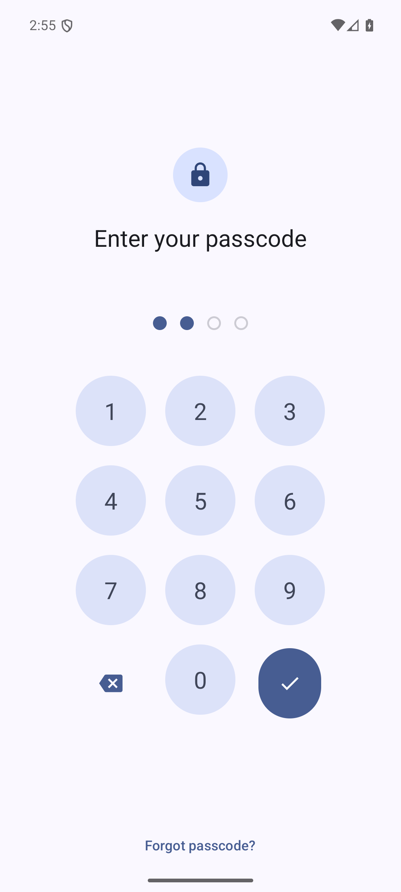

# AndroidAppLockscreen

A passcode lock screen for Android apps. Add it in a few lines, and your app asks for a 4 to 8 digit passcode when it opens and every time people come back to it. People can set, change and turn off the passcode, and unlock with their fingerprint if you allow it.

## Screenshots

Light                                  | Dark
:-------------------------------------:|:-------------------------------------:
   | 

## What you get

1. **A clean Material 3 lock screen** that follows light and dark mode, and uses the phone's own colours on Android 12 and newer.
2. **Your own look if you want it:** pass your theme with `EasyLock.setTheme()`, or set a background colour.
3. **Smooth feedback:** dots fill in as you type, shake on a wrong passcode, and every key gives a small vibration.
4. **Fingerprint or face unlock,** turned on with one line.
5. **Locks again when people come back** to your app after leaving it.
6. **Passcodes are stored as a salted hash,** not as plain text.
7. **Works from Kotlin and Java,** on Android 5.0 (API 21) and newer.

## Install

Add JitPack to `settings.gradle.kts`:

```kotlin
dependencyResolutionManagement {
    repositories {
        google()
        mavenCentral()
        maven("https://jitpack.io")
    }
}
```

Add the library:

```kotlin
dependencies {
    implementation("com.github.p32929:AndroidAppLockscreen:2.0.0")
}
```

## Usage

1. Extend your activities from `LockscreenHandler`.
2. Call `EasyLock.checkPassword(this)` in `onCreate` of the activity your app opens first.

Kotlin:

```kotlin
class MainActivity : LockscreenHandler() {
    override fun onCreate(savedInstanceState: Bundle?) {
        super.onCreate(savedInstanceState)
        setContentView(R.layout.activity_main)

        if (savedInstanceState == null) EasyLock.checkPassword(this)

        setButton.setOnClickListener { EasyLock.setPassword(this) }
    }
}
```

Java:

```java
public class MainActivity extends LockscreenHandler {
    @Override
    protected void onCreate(Bundle savedInstanceState) {
        super.onCreate(savedInstanceState);
        setContentView(R.layout.activity_main);

        if (savedInstanceState == null) EasyLock.checkPassword(this);
    }
}
```

## API

| Call | What it does |
|---|---|
| `EasyLock.setPassword(context)` | Asks for a new passcode twice and saves it |
| `EasyLock.checkPassword(context)` | Shows the lock screen, if a passcode is set |
| `EasyLock.changePassword(context)` | Asks for the current passcode, then a new one |
| `EasyLock.disablePassword(context)` | Asks for the current passcode, then turns the lock off |
| `EasyLock.isPasswordSet(context)` | Tells you if a passcode is set |
| `EasyLock.setBiometricEnabled(true)` | Lets people unlock with fingerprint or face |
| `EasyLock.forgotPassword { ... }` | Shows a "Forgot passcode?" button that runs your code |
| `EasyLock.setTheme(R.style.MyTheme)` | Uses your own Material 3 theme on the lock screen |
| `EasyLock.setBackgroundColor(color)` | Sets a background colour |

`setPassword`, `changePassword` and `disablePassword` can also take an activity class to open when they finish, like in 1.x: `EasyLock.setPassword(this, MainActivity::class.java)`. Without it, the lock screen just closes and you are back where you were.

See the `app` module for a full working sample.

## Migrating from 1.x

1. Update the version to `2.0.0`. Your 1.x calls keep working, and saved passcodes still unlock.
2. The library now needs Android 5.0 (API 21) or newer, and a Material 3 or Material Components theme if you pass your own with `setTheme()`.
3. The lock screen uses its theme colours instead of a black background. Call `EasyLock.setBackgroundColor(Color.BLACK)` to keep the old look.
4. `disablePassword()` now asks for the current passcode first, so the lock can't be turned off by anyone holding the phone.
5. Passcodes must be 4 to 8 digits.
6. The `ActivityChanger` interface is gone. It was only used inside the library.
7. Old 1.x versions stay on JitPack, so nothing breaks if you don't update.

## License

MIT License — Copyright (c) 2018 Fayaz Bin Salam. See [LICENSE](LICENSE) for the full text.

## Contributing

Contributions are very welcome, thank you! Before you start on a pull request, please open an issue and tell me what you would like to add or change. That way we can agree on it first, and your time is not wasted on something that might not fit. Thanks for helping make AndroidAppLockscreen better.

## Share

<a href="https://p32929.github.io/share/?repo=AndroidAppLockscreen"><picture><source media="(prefers-color-scheme: dark)" srcset="https://p32929.github.io/readme/share-dark.svg"></picture></a>

## Support

<a href="https://p32929.github.io/support/"><picture><source media="(prefers-color-scheme: dark)" srcset="https://p32929.github.io/readme/support-dark.svg"></picture></a>
