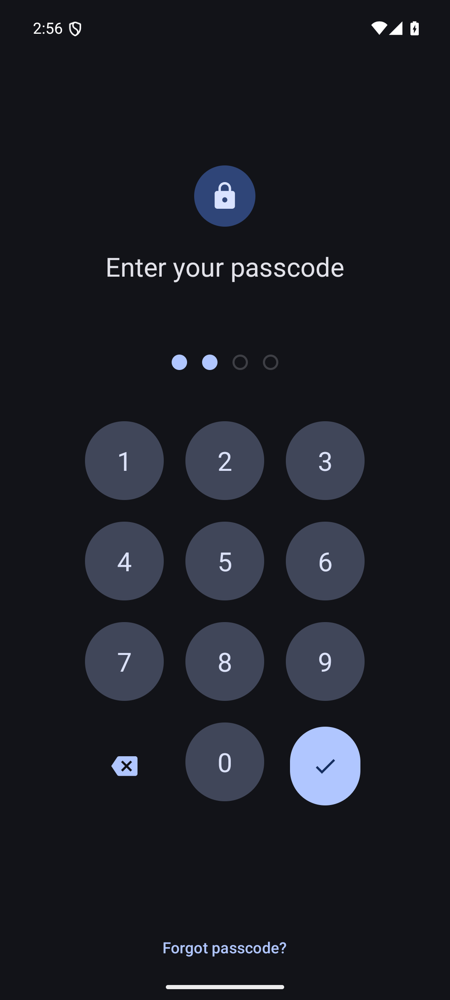

# AndroidAppLockscreen

A passcode lock screen for Android apps. Add it in a few lines, and your app asks for a 4 to 8 digit passcode when it opens and every time people come back to it. People can set, change and turn off the passcode, and unlock with their fingerprint if you allow it.

## Screenshots

Light                                  | Dark
:-------------------------------------:|:-------------------------------------:
   | 

## What you get

1. **A clean Material 3 lock screen** that follows light and dark mode, and uses the phone's own colours on Android 12 and newer.
2. **Your own look if you want it:** pass your theme with `EasyLock.setTheme()`, or set a background colour.
3. **Smooth feedback:** dots fill in as you type, shake on a wrong passcode, and every key gives a small vibration.
4. **Fingerprint or face unlock,** turned on with one line.
5. **Locks again when people come back** to your app after leaving it.
6. **Passcodes are stored as a salted hash,** not as plain text.
7. **Works from Kotlin and Java,** on Android 5.0 (API 21) and newer.

## Install

Add JitPack to `settings.gradle.kts`:

```kotlin
dependencyResolutionManagement {
    repositories {
        google()
        mavenCentral()
        maven("https://jitpack.io")
    }
}
```

Add the library:

```kotlin
dependencies {
    implementation("com.github.p32929:AndroidAppLockscreen:2.0.0")
}
```

## Usage

1. Extend your activities from `LockscreenHandler`.
2. Call `EasyLock.checkPassword(this)` in `onCreate` of the activity your app opens first.

Kotlin:

```kotlin
class MainActivity : LockscreenHandler() {
    override fun onCreate(savedInstanceState: Bundle?) {
        super.onCreate(savedInstanceState)
        setContentView(R.layout.activity_main)

        if (savedInstanceState == null) EasyLock.checkPassword(this)

        setButton.setOnClickListener { EasyLock.setPassword(this) }
    }
}
```

Java:

```java
public class MainActivity extends LockscreenHandler {
    @Override
    protected void onCreate(Bundle savedInstanceState) {
        super.onCreate(savedInstanceState);
        setContentView(R.layout.activity_main);

        if (savedInstanceState == null) EasyLock.checkPassword(this);
    }
}
```

## API

| Call | What it does |
|---|---|
| `EasyLock.setPassword(context)` | Asks for a new passcode twice and saves it |
| `EasyLock.checkPassword(context)` | Shows the lock screen, if a passcode is set |
| `EasyLock.changePassword(context)` | Asks for the current passcode, then a new one |
| `EasyLock.disablePassword(context)` | Asks for the current passcode, then turns the lock off |
| `EasyLock.isPasswordSet(context)` | Tells you if a passcode is set |
| `EasyLock.setBiometricEnabled(true)` | Lets people unlock with fingerprint or face |
| `EasyLock.forgotPassword { ... }` | Shows a "Forgot passcode?" button that runs your code |
| `EasyLock.setTheme(R.style.MyTheme)` | Uses your own Material 3 theme on the lock screen |
| `EasyLock.setBackgroundColor(color)` | Sets a background colour |

`setPassword`, `changePassword` and `disablePassword` can also take an activity class to open when they finish, like in 1.x: `EasyLock.setPassword(this, MainActivity::class.java)`. Without it, the lock screen just closes and you are back where you were.

See the `app` module for a full working sample.

## Migrating from 1.x

1. Update the version to `2.0.0`. Your 1.x calls keep working, and saved passcodes still unlock.
2. The library now needs Android 5.0 (API 21) or newer, and a Material 3 or Material Components theme if you pass your own with `setTheme()`.
3. The lock screen uses its theme colours instead of a black background. Call `EasyLock.setBackgroundColor(Color.BLACK)` to keep the old look.
4. `disablePassword()` now asks for the current passcode first, so the lock can't be turned off by anyone holding the phone.
5. Passcodes must be 4 to 8 digits.
6. The `ActivityChanger` interface is gone. It was only used inside the library.
7. Old 1.x versions stay on JitPack, so nothing breaks if you don't update.

## Support

If you like my works and want to support me/my works, feel free to support or donate. My payment details can be found here: https://p32929.github.io/SendMoney2MeV1/

## License

MIT License — Copyright (c) 2018 Fayaz Bin Salam. See [LICENSE](LICENSE) for the full text.

## Contributing

Contributions are warmly welcomed and greatly appreciated! Whether it's a bug fix, new feature, or improvement, your input helps make this project better for everyone.

Before submitting a pull request, please:

1. Create an issue describing the feature or bug fix you'd like to work on
2. Wait for discussion and approval to ensure alignment with project goals
3. Fork the repository and create your feature branch
4. Submit your pull request with a clear description of changes

This approach helps avoid duplicate efforts and ensures smooth collaboration. Thank you for considering contributing!

## Share

Sharing this repository with your friends is just one click away from here

[](https://www.facebook.com/sharer/sharer.php?u=https://github.com/p32929/AndroidAppLockscreen/)
[](https://twitter.com/intent/tweet?url=https://github.com/p32929/AndroidAppLockscreen/)
[](https://www.tumblr.com/share?v=3&u=https://github.com/p32929/AndroidAppLockscreen/)
[](https://getpocket.com/save?url=https://github.com/p32929/AndroidAppLockscreen/)
[](https://pinterest.com/pin/create/button/?url=https://github.com/p32929/AndroidAppLockscreen/)
[](https://www.reddit.com/submit?url=https://github.com/p32929/AndroidAppLockscreen/)
[](https://www.linkedin.com/shareArticle?mini=true&url=https://github.com/p32929/AndroidAppLockscreen/)
[](https://api.whatsapp.com/send?text=https://github.com/p32929/AndroidAppLockscreen/)

---

## Support

If this saved you time, you can buy me a coffee — it keeps these projects maintained and free.

[](https://www.buymeacoffee.com/p32929)

**Sponsor a mention** — $499 one-time: your name + link in this section for 3 months. **$1,200 one-time:** featured placement at the top of this section, plus a pinned mention on [my X profile](https://x.com/p32929), for 3 months. Email **[fayazdevinbox@uberip.com](mailto:fayazdevinbox@uberip.com)** for an invoice.

<!-- hire-block -->

---

## 💼 Using this at a company?

I do fixed-price delivery work on my own projects. One invoice, one date, no hourly billing:

| | |
|---|---|
| **White-label build** — this project rebranded, extended and deployed as yours | **$6,500** · 3 weeks |
| **Custom app from scratch** on my own stack, signed and auto-updating | **$12,500** · 6 weeks |
| **Production-hardening sprint** — 72 hours on this project, for your load and your security review | **$999** |
| **Ongoing capacity** — one project-week of my time reserved every month | **$9,000 / month** |

Full details → **[p32929.github.io/hire](https://p32929.github.io/hire/)** · Email **[fayazdevinbox@uberip.com](mailto:fayazdevinbox@uberip.com)** — scoping and quotes are free and I answer within one business day.
